# ✈️ Flight Booking System

> **Academic DBMS Project Based Learning (PBL)**  
> **Course:** Database Management Systems (B.Tech Computer Science & Engineering)  
> **Stack:** MySQL 8.x + Python 3 (Tkinter / ttk) + Git / GitHub

---

## 1. Overview

The **Flight Booking System** is an academic database-driven desktop application engineered to demonstrate relational database management concepts, database normalization (UNF through 3NF), relational integrity constraints, SQL DDL/DML implementation, and Python–database connectivity via `mysql-connector-python`. The system allows users and administrators to search flights across major domestic routes, register passengers, make seat reservations with transactional integrity, inspect active bookings, process simulated ticket cancellations, record simulated payments, and generate analytical business reports (revenue by airline, flight seat occupancy, and scheduling summaries).

> [!IMPORTANT]
> **Academic Prototype & Simulation Disclaimer:**  
> All flight schedules, aircraft registrations, airport routes, ticket fares, passenger profiles, and payment transactions in this project are **strictly sample and simulated data** designed solely for college laboratory demonstration and academic evaluation. This system does not interface with any real airline Global Distribution System (GDS), live flight tracking API, or live banking/payment gateway.

---

## 2. Features

Only features that are fully implemented and verified in the application are listed below:

- **Interactive Metric Dashboard:** Real-time KPI summary cards displaying live counts for registered airlines, scheduled flights, registered passengers, active bookings, and total collected revenue directly aggregated from MySQL. Includes an "Upcoming Flights" schedule overview.
- **Parametric Flight Search:** Search scheduled flights by origin airport, destination airport, travel date, and travel class (Economy / Business) using parameterized SQL queries. Dynamically displays flight numbers, carrier names, departure/arrival timestamps, aircraft models, base fares, and real-time available seat counts.
- **Passenger Management:** Complete passenger directory supporting registration, search, record updating, and deletion. Form inputs are validated for email format, 10-digit Indian mobile numbers, and valid date formats prior to executing database operations.
- **Transactional Flight Booking:** Create flight reservations with explicit ACID transaction boundaries (`conn.start_transaction()`, `SELECT ... FOR UPDATE`, and `conn.commit()`). Generates unique 8-character alphanumeric booking references (e.g., `BK2MV3U0`), verifies real-time seat availability, dynamically estimates class fares, and inserts both reservation and ticket records atomically.
- **Booking Management & Inspection:** Browse all historical and active reservations, search by booking reference, view associated passenger and flight details, and inspect the complete lifecycle status history of each reservation.
- **Booking Cancellation & Status Tracking:** Cancel confirmed reservations with atomic transaction handling. Automatically transitions ticket status to `Cancelled`, updates booking status to `Cancelled`, records an audit event in `booking_status_history` via a database trigger, and marks the corresponding payment record as `Refunded`.
- **Simulated Payment Management:** Record and review simulated payment transactions associated with valid booking references. Supports payment method selection (Credit Card, Debit Card, UPI, Net Banking) and stores transaction references and payment statuses (`Completed`, `Pending`, `Refunded`).
- **Analytical Reporting:**
  - **Revenue by Airline:** Aggregates ticket sales, confirmed booking counts, and total revenue per airline carrier.
  - **Flight Seat Occupancy:** Computes real-time capacity utilization percentages for every scheduled flight based on active tickets sold.
  - **Flight Schedules Master:** Administrative overview of all scheduled, delayed, and cancelled flight instances across the network.
- **Administrative Flight & Fleet Overview:** View carrier information, aircraft specifications (total, economy, and business seat splits), airport records, and operating flight schedules.

---

## 3. Technology Stack

| Layer | Technology | Details & Role |
|---|---|---|
| **Database** | MySQL 8.x | Relational DBMS hosting `flight_booking_db` with InnoDB engine, foreign keys, triggers, views, and check constraints |
| **Language** | Python 3 (3.15+) | Core application logic, repositories, and UI framework |
| **Database Connector** | `mysql-connector-python` (>=9.3.0 / 26.10.0) | Pure Python MySQL driver for connection management and parameterized query execution |
| **Desktop Frontend** | Tkinter & `ttk` | Native desktop GUI using the `clam` theme for macOS light/dark appearance compatibility |
| **Data Presentation** | `ttk.Treeview` | Structured tabular displays with column sorting and vertical scrollbars |
| **Testing Framework** | `pytest` (8.3.5) | Automated test harness executing unit validation and live database integration suites |
| **Configuration** | `python-dotenv` (1.1.0) | Loads database credentials securely from local `.env` |
| **Documentation** | `python-docx` (1.1.2) | Generates the 35-section academic project report (`.docx`) |
| **Version Control** | Git & GitHub | Source code tracking and remote backup |

---

## 4. Database Design

The relational schema is implemented in **MySQL 8.x** under the database name `flight_booking_db`. It consists of **9 normalized tables (3NF)**, **3 database views**, and **6 business logic triggers**.

### Tables & Relational Structure

| # | Table Name | Purpose | Key Constraints |
|---|---|---|---|
| 1 | `airlines` | Stores airline carrier names, unique codes, and contact details. | Primary Key (`airline_id`), UNIQUE (`airline_code`), CHECK email format |
| 2 | `airports` | Stores domestic airport details and standard 3-letter IATA codes. | Primary Key (`airport_id`), UNIQUE (`airport_code`) |
| 3 | `aircraft` | Manages aircraft fleet models, registration numbers, and seat split. | Primary Key (`aircraft_id`), UNIQUE (`registration_number`), Foreign Key (`airline_id` → `airlines`), CHECK (`economy_seats + business_seats = total_seats`) |
| 4 | `flight_schedules` | Defines flight instances, routes, timestamps, fares, and statuses. | Primary Key (`flight_id`), Foreign Keys (`airline_id`, `aircraft_id`, `origin_airport_id`, `destination_airport_id`), CHECK (`base_fare > 0`), Triggers prevent origin == destination |
| 5 | `passengers` | Stores registered passenger demographics and contact information. | Primary Key (`passenger_id`), CHECK email format, CHECK phone length |
| 6 | `bookings` | Master reservation header with timestamp, status, and total amount. | Primary Key (`booking_id`), UNIQUE (`booking_reference`), Foreign Key (`passenger_id` → `passengers`) |
| 7 | `tickets` | Per-seat passenger ticket linking a booking to a specific flight and seat. | Primary Key (`ticket_id`), Foreign Keys (`booking_id`, `passenger_id`, `flight_id`), UNIQUE (`flight_id`, `seat_number`), CHECK (`ticket_fare >= 0`) |
| 8 | `payments` | Records simulated financial transactions and payment states. | Primary Key (`payment_id`), UNIQUE (`payment_reference`), Foreign Key (`booking_id` → `bookings`) |
| 9 | `booking_status_history` | Audit trail logging state transitions (`Confirmed` → `Cancelled`). | Primary Key (`history_id`), Foreign Key (`booking_id` → `bookings`), Populated automatically via triggers |

### Database Views
- `v_active_flights`: Summarizes scheduled/active flights joined with carrier names and origin/destination airport cities.
- `v_booking_summary`: Comprehensive denormalized reservation report joining bookings, passengers, flight details, and ticket fares.
- `v_airline_revenue`: Financial aggregation view computing total bookings and total earned revenue grouped by airline.

### Triggers
- `trg_prevent_same_airport` / `trg_prevent_same_airport_update`: Enforces that `origin_airport_id <> destination_airport_id` on insert/update.
- `trg_booking_history_insert` / `trg_booking_history_update`: Automatically appends audit rows to `booking_status_history` upon reservation creation or status modification.
- `trg_aircraft_seats_check` / `trg_aircraft_seats_check_update`: Verifies seat capacity consistency before inserting or modifying aircraft records.

### Entity-Relationship (ER) Diagram
The Mermaid ER diagram source code is maintained in [`diagrams/er_diagram.mmd`](diagrams/er_diagram.mmd).

```
airlines (1) ────< aircraft (N) ────< flight_schedules (N)
airports (1) ────< flight_schedules [origin & destination]
passengers (1) ──< bookings (N) ────< tickets (N) >──── flight_schedules (1)
bookings (1) ────< payments (N)
bookings (1) ────< booking_status_history (N)
```

---

## 5. Project Folder Structure

The project directory is structured as follows:

```
flight_booking_system/
├── .env.example                          # Template for database credentials (safe to commit)
├── .gitignore                            # Excludes .env, .venv/, __pycache__/, .DS_Store
├── PROGRESS.md                           # Development milestone and checkpoint log
├── README.md                             # Comprehensive project documentation
├── requirements.txt                      # Python library dependencies
├── database/
│   ├── queries.sql                       # Sample data inserts and 30 demonstration SQL queries
│   └── schema.sql                        # DDL: schema creation, 9 tables, 3 views, 6 triggers
├── diagrams/
│   └── er_diagram.mmd                    # Mermaid Entity-Relationship diagram source
├── report/
│   └── Flight_Booking_System_Report.docx # 35-section academic project report with embedded figures
├── screenshots/                          # Real application GUI captures from macOS
│   ├── 01_dashboard.png                  # Dashboard with live metric cards and flight schedule table
│   ├── 02_flight_search_form.png         # Flight search inquiry form
│   ├── 03_flight_search_results.png      # Query results for DEL -> BOM route
│   ├── 05_passenger_list.png             # Passenger registration form & live MySQL records
│   ├── 06_booking_form.png               # Booking reservation form with live fare calculation
│   ├── 07_booking_confirmed.png          # Booking detail view and audit trail for BK2MV3U0
│   ├── 08_booking_list.png               # Master booking records table
│   ├── 10_cancellation.png               # Cancelled reservation state and ticket release audit
│   ├── 11_payments.png                   # Simulated payment records table
│   ├── 12_revenue_report.png             # Revenue by Airline analytical report
│   ├── 13_occupancy_report.png           # Flight seat occupancy report
│   └── 14_admin_schedules.png            # Administrative flight schedules master view
├── src/
│   ├── __init__.py
│   ├── db_connection.py                  # Database connection factory & health check
│   ├── generate_report.py                # Python script to compile the DOCX academic report
│   ├── main.py                           # Application entry point (Tkinter GUI runner)
│   ├── validators.py                     # Business validation routines and reference generator
│   ├── repositories/                     # Data Access Layer (parameterized SQL operations)
│   │   ├── __init__.py
│   │   ├── airline_repository.py         # Airline entity queries
│   │   ├── airport_repository.py         # Airport entity queries
│   │   ├── booking_repository.py         # Transactional booking creation and cancellation
│   │   ├── flight_repository.py          # Flight search, schedule, and occupancy queries
│   │   ├── passenger_repository.py       # Passenger CRUD operations
│   │   └── payment_repository.py         # Payment creation and lookup operations
│   └── ui/                               # Modular Tkinter GUI frames
│       ├── __init__.py
│       ├── bookings.py                   # Booking creation, search, and cancellation UI
│       ├── dashboard.py                  # Metric cards and upcoming schedule UI
│       ├── flight_search.py              # Flight search and seat availability UI
│       ├── flights.py                    # Flight schedule admin UI
│       ├── passengers.py                 # Passenger registration and directory UI
│       ├── payments.py                   # Payment recording and history UI
│       └── reports.py                    # Analytical reporting UI
└── tests/                                # Automated test suite (72 tests)
    ├── __init__.py
    ├── test_db.py                        # 21 integration tests (TC01 - TC21) against live MySQL
    └── test_validators.py                # 51 unit tests for inputs and business validation logic
```

---

## 6. Setup on macOS (zsh)

Follow these exact steps in macOS Terminal (`zsh`) to set up and run the system.

### Step 1: Install System Prerequisites
Install MySQL 8 and Python Tkinter support via Homebrew:
```zsh
brew install mysql python-tk
```

Start the MySQL background service:
```zsh
brew services start mysql
```

Verify MySQL is running:
```zsh
brew services list | grep mysql
```

### Step 2: Navigate to Project and Set Up Virtual Environment
```zsh
cd ~/flight_booking_system
python3 -m venv .venv
source .venv/bin/activate
```

### Step 3: Install Python Dependencies
```zsh
pip install -r requirements.txt
```

### Step 4: Configure Database Credentials
Create your local `.env` configuration file from the template:
```zsh
cp .env.example .env
```
Open `.env` in your text editor and set your local MySQL password:
```ini
DB_HOST=localhost
DB_PORT=3306
DB_USER=root
DB_PASSWORD=your_actual_mysql_password
DB_NAME=flight_booking_db
```
*(Note: `.env` is strictly ignored by Git and will never be tracked or pushed).*

### Step 5: Initialize the Database (DDL & DML)
Load the database schema (creates `flight_booking_db`, tables, views, and triggers):
```zsh
mysql -u root -p < database/schema.sql
```

Load the sample data and demonstration queries:
```zsh
mysql -u root -p flight_booking_db < database/queries.sql
```

### Step 6: Verify Database Connectivity
Verify that Python connects successfully to `flight_booking_db` using the connection helper:
```zsh
python3 -c "from src.db_connection import test_connection; print('Connected:', test_connection())"
```
*Expected output:* `Connected: True`

You can also inspect the populated tables from the command line:
```zsh
mysql -u root -p flight_booking_db -e "SELECT table_name, table_rows FROM information_schema.tables WHERE table_schema='flight_booking_db';"
```

### Step 7: Launch the Application
```zsh
python3 src/main.py
```

---

## 7. Running the Automated Tests

The project includes a comprehensive two-tier test suite:
1. **Unit Tests (`tests/test_validators.py`):** 51 tests covering input validation routines (email, phone, dates, seat codes, fare amounts, name syntax, and unique booking reference generation).
2. **Integration Tests (`tests/test_db.py`):** 21 tests covering all documented test cases (`TC01` through `TC21`) against a live MySQL database (table integrity, foreign key rejection, duplicate seat conflict, capacity overflow, transactions, and triggers).

To run the complete test suite:
```zsh
source .venv/bin/activate
pytest tests/ -v
```

### Real Test Execution Results
```
============================= test session starts ==============================
platform darwin -- Python 3.15.2, pytest-8.3.5, pluggy-1.7.0 -- .venv/bin/python3.15
cachedir: .pytest_cache
rootdir: /Users/ayushsawhney/flight_booking_system
collected 72 items

tests/test_db.py::test_TC01_database_exists PASSED                       [  1%]
tests/test_db.py::test_TC02_all_tables_exist PASSED                      [  2%]
tests/test_db.py::test_TC03_sample_data_counts PASSED                    [  4%]
tests/test_db.py::test_TC04_successful_connection PASSED                 [  5%]
tests/test_db.py::test_TC05_flight_search PASSED                         [  6%]
tests/test_db.py::TestTC06PassengerRegistration::test_add_and_retrieve PASSED [  8%]
tests/test_db.py::TestTC07BookingCreation::test_create_booking PASSED    [  9%]
tests/test_db.py::test_TC08_unique_booking_reference PASSED              [ 11%]
tests/test_db.py::TestTC09DuplicateSeat::test_duplicate_seat_rejected PASSED [ 12%]
tests/test_db.py::test_TC10_capacity_overflow PASSED                     [ 13%]
tests/test_db.py::test_TC11_invalid_fk_rejection PASSED                  [ 15%]
tests/test_db.py::test_TC12_invalid_travel_class PASSED                  [ 16%]
tests/test_db.py::test_TC13_negative_fare PASSED                         [ 18%]
tests/test_db.py::test_TC14_cancelled_flight_booking PASSED              [ 19%]
tests/test_db.py::TestTC15TC16CancellationAndSeatRelease::test_TC15_cancellation PASSED [ 20%]
tests/test_db.py::TestTC15TC16CancellationAndSeatRelease::test_TC16_seat_release PASSED [ 22%]
tests/test_db.py::test_TC17_payment_status PASSED                        [ 23%]
tests/test_db.py::test_TC18_join_query PASSED                            [ 25%]
tests/test_db.py::test_TC19_revenue_accuracy PASSED                      [ 26%]
tests/test_db.py::test_TC20_transaction_rollback PASSED                  [ 27%]
tests/test_db.py::test_TC21_connection_error_handling PASSED             [ 29%]
tests/test_validators.py::TestValidateEmail (6 tests) PASSED            [ 37%]
tests/test_validators.py::TestValidatePhone (6 tests) PASSED            [ 45%]
tests/test_validators.py::TestValidateDateString (5 tests) PASSED        [ 52%]
tests/test_validators.py::TestValidateTravelClass (4 tests) PASSED       [ 58%]
tests/test_validators.py::TestValidatePassengerCount (6 tests) PASSED   [ 66%]
tests/test_validators.py::TestValidateFare (5 tests) PASSED             [ 73%]
tests/test_validators.py::TestValidateName (5 tests) PASSED             [ 80%]
tests/test_validators.py::TestValidateSeatNumber (7 tests) PASSED       [ 90%]
tests/test_validators.py::TestGenerateBookingReference (2 tests) PASSED  [ 93%]
tests/test_validators.py::TestValidateDifferentAirports (2 tests) PASSED [ 95%]
tests/test_validators.py::TestCollectErrors (3 tests) PASSED            [100%]

============================== 72 passed in 1.80s ==============================
```

---

## 8. Application Screenshots

All screenshots below represent **genuine user captures** of the running Tkinter frontend on macOS connected to the live MySQL database:

### Figure 1: Application Dashboard
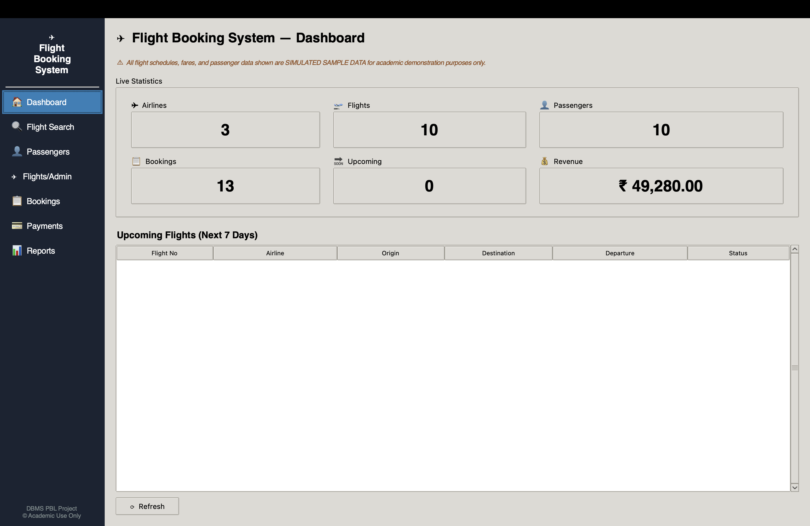  
*Live metrics overview showing real-time statistics (3 Airlines, 10 Flights, 10 Passengers, 13 Bookings, ₹ 49,280.00 Revenue) and upcoming flight schedules.*

### Figure 2: Flight Search Form (Initial State)
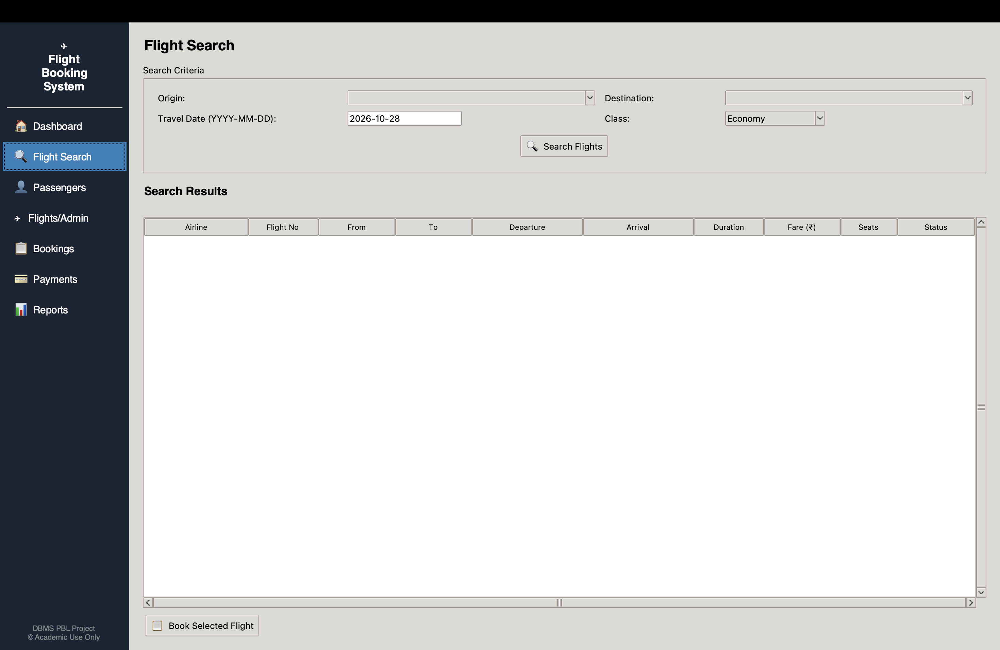  
*Search interface with origin and destination airport selectors, travel date input, and travel class dropdown prior to query execution.*

### Figure 3: Flight Search Results
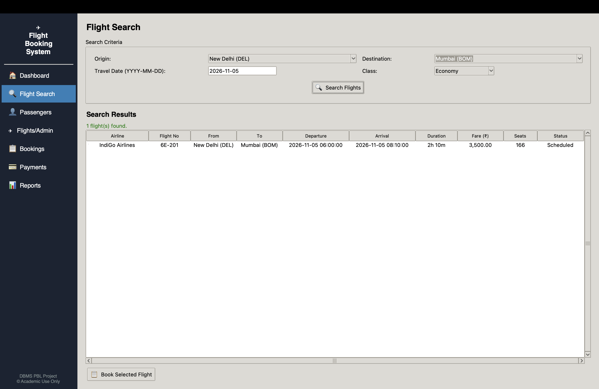  
*Flight search results for DEL → BOM on 2026-11-05 displaying flight 6E-201, departure/arrival times, aircraft model, fare (₹ 3,500.00), and remaining seats.*

### Figure 4: Passenger Management
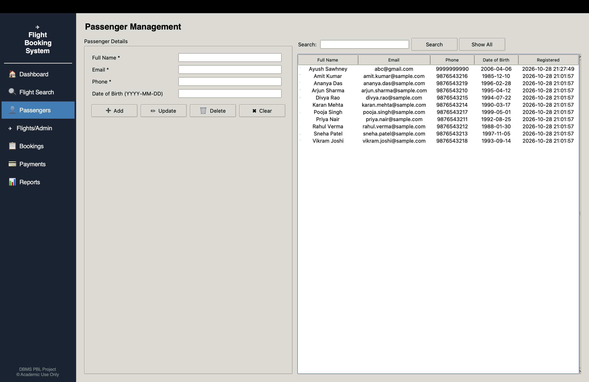  
*Passenger registration form on the left with full validation rules, alongside the live MySQL passenger directory on the right.*

### Figure 5: Flight Reservation Form
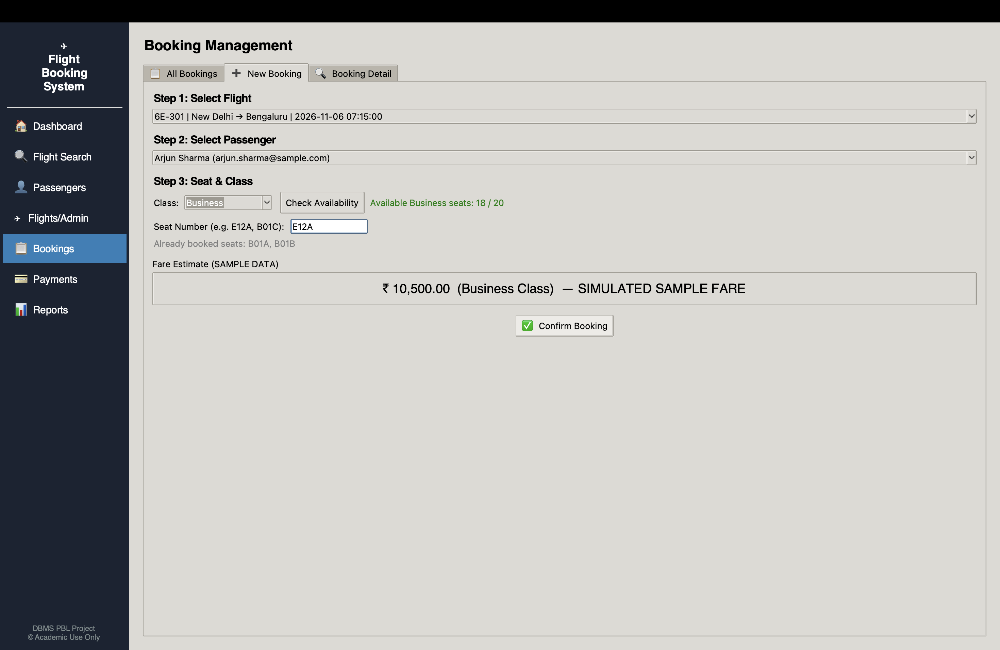  
*Booking creation screen showing passenger selection (Arjun Sharma), flight selection (6E-301), travel class (Business), seat input (E12A), and live fare calculation (₹ 10,500.00).*

### Figure 6: Booking Confirmation & Status History
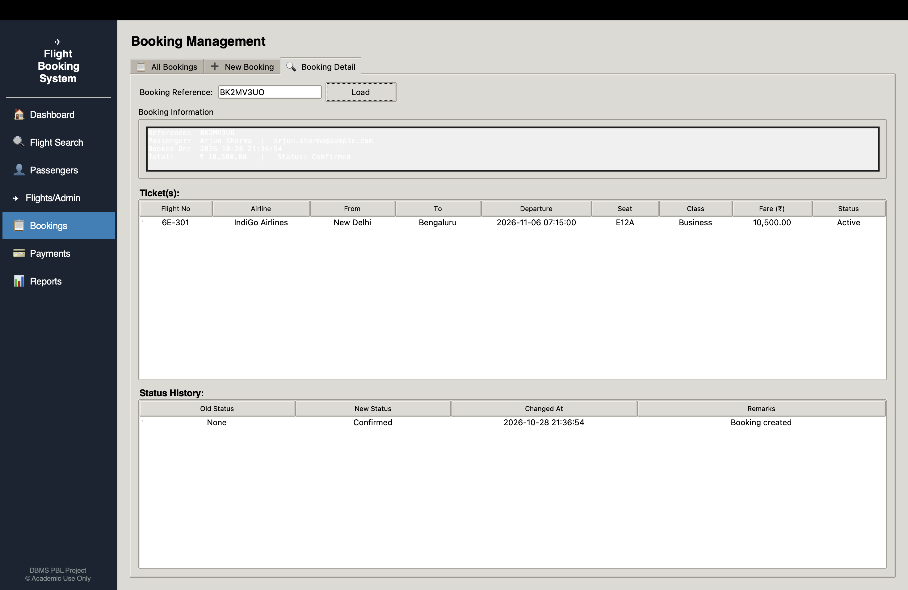  
*Booking detail tab displaying confirmed reservation BK2MV3U0, ticket allocation, and the initial status audit history record.*

### Figure 7: Master Bookings List
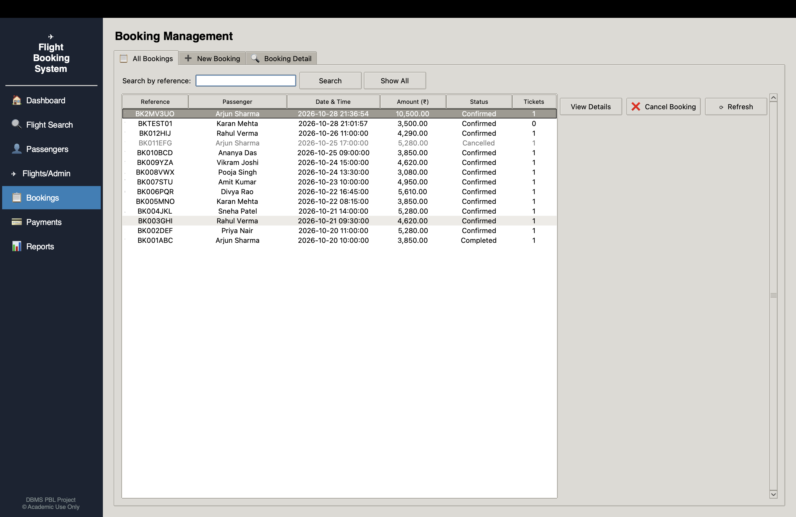  
*Master overview of all customer reservations recorded in MySQL showing booking references, passenger names, flight routes, total fares, and booking statuses.*

### Figure 8: Booking Cancellation & Audit History
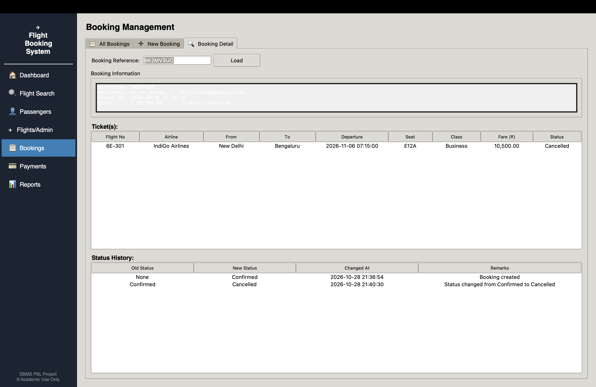  
*Reservation BK2MV3U0 following cancellation: booking status updated to Cancelled, ticket marked Cancelled, and audit history logging the transition event.*

### Figure 9: Payment Management
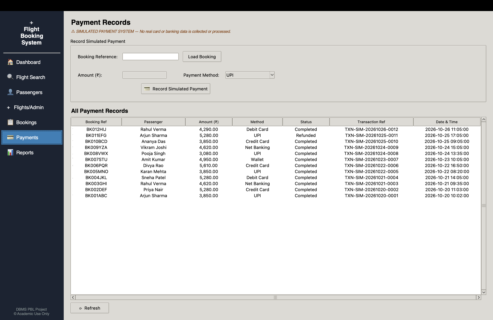  
*Simulated payment management module showing payment recording form and live transaction records with payment references and statuses.*

### Figure 10: Analytical Report — Revenue by Airline
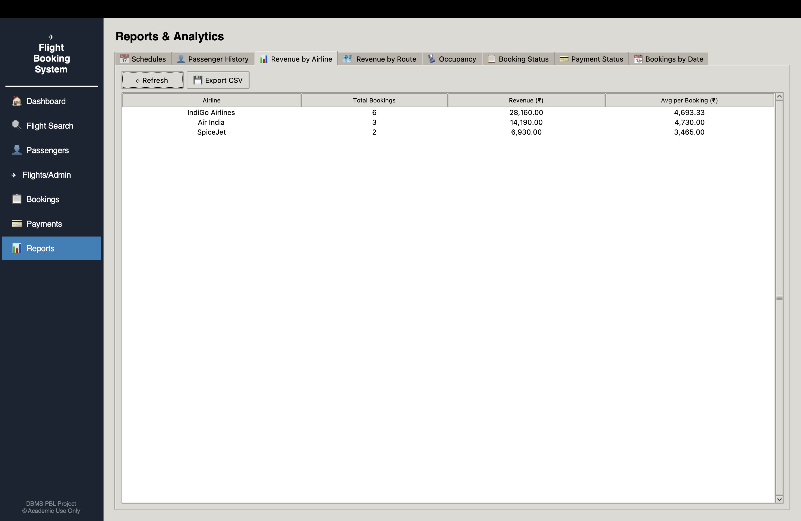  
*Business report aggregating total bookings and revenue collected across airlines (IndiGo: ₹ 28,160.00, Air India: ₹ 14,190.00, SpiceJet: ₹ 6,930.00).*

### Figure 11: Analytical Report — Flight Seat Occupancy
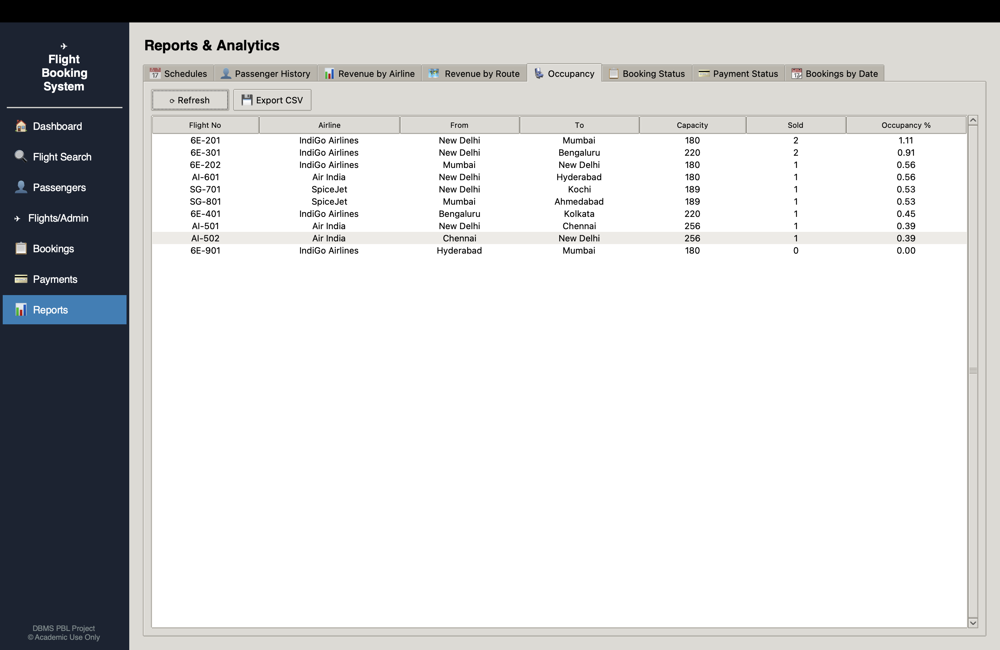  
*Real-time flight seat occupancy report calculating total capacities, tickets sold, and capacity utilization percentages.*

### Figure 12: Administrative Flight Schedules
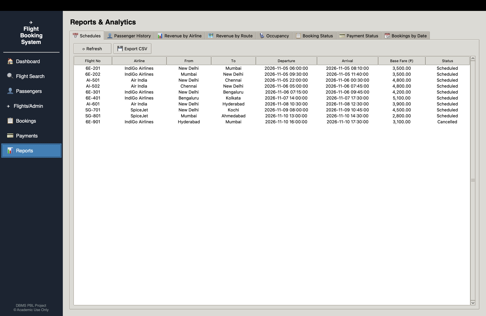  
*Master flight schedule administration view showing flight routes, schedules, base fares, and flight statuses.*

---

## 9. Booking Logic & Double-Booking Prevention

The system implements multi-layered transactional consistency to prevent invalid bookings and overbooking:

1. **Atomic Transaction Scope:** Booking creation in [`src/repositories/booking_repository.py`](src/repositories/booking_repository.py) runs inside an explicit transaction (`conn.start_transaction()`). If any validation or insert step fails, `conn.rollback()` restores the database state.
2. **Pessimistic Row Locking (`FOR UPDATE`):** When booking, the flight schedule row is locked with `SELECT flight_status FROM flight_schedules WHERE flight_id=%s FOR UPDATE` to prevent concurrent modifications while reading status.
3. **Capacity Threshold Verification:** The repository queries the aircraft class capacity (`economy_seats` or `business_seats`) and counts active tickets (`SELECT COUNT(*) FROM tickets WHERE flight_id=%s AND travel_class=%s AND ticket_status='Active'`). If `booked >= capacity`, the transaction is rolled back and a `RuntimeError` is raised.
4. **Relational Seat Uniqueness Constraint:** The `tickets` table enforces a composite unique key:
   ```sql
   CONSTRAINT uq_flight_seat UNIQUE (flight_id, seat_number)
   ```
   If a duplicate seat number is assigned to the same flight, MySQL immediately throws error `1062 (Duplicate entry)`, triggering an immediate rollback.
5. **Academic Scope Note:** This implementation provides robust transactional consistency suitable for a single-database desktop system. It does not implement distributed locking, GDS PNR queuing, or multi-seat reservation shopping carts. In this prototype, cancelling a booking updates `ticket_status` to `Cancelled` and releases class capacity for the flight, while the historical row remains in `tickets` for audit purposes.

---

## 10. macOS Troubleshooting

| Issue | Root Cause | Solution |
|---|---|---|
| `ModuleNotFoundError: No module named 'tkinter'` | System Python on macOS does not include Tkinter by default. | Run `brew install python-tk` and ensure your virtual environment uses the Homebrew Python binary. |
| `Can't connect to local MySQL server through socket` | MySQL service is not running. | Run `brew services start mysql` and verify status with `brew services list`. |
| `Access denied for user 'root'@'localhost'` | Incorrect password specified in `.env`. | Open `.env` and verify `DB_PASSWORD` matches the password configured during MySQL installation. |
| `Unknown database 'flight_booking_db'` | Database schema has not been imported yet. | Execute `mysql -u root -p < database/schema.sql` to initialize the database. |
| `AttributeError: module 'ssl' has no attribute 'PROTOCOL_TLSv1'` | Python 3.15 removed deprecated TLSv1 constants in older connector packages. | Use `mysql-connector-python>=9.3.0` (installed version `26.10.0`), which contains compatibility patches for Python 3.15. |
| Tkinter styling appears broken or unreadable | macOS Dark Mode overriding standard native widgets. | The application explicitly enforces the `clam` theme with explicit hex foreground/background definitions to guarantee readability across all macOS display modes. |

---

## 11. Known Limitations

- **Simulated Sample Data:** All flight schedules, aircraft registrations, airport codes, passenger profiles, and payment references are purely synthetic.
- **Single-Seat Booking Workflow:** The desktop UI is designed for single-passenger reservations per booking transaction. Group bookings with multiple tickets are supported in the database schema but require separate booking transactions in the frontend prototype.
- **Simulated Payment Gateway:** No real banking gateway or external payment API is integrated; payments are processed as simulated records directly within MySQL.
- **Screenshot Coverage Note:** Out of 14 planned screenshots, 12 genuine captures were taken and embedded. Two planned dialog screenshots (`04_passenger_registration.png` and `09_booking_detail.png`) were omitted to avoid artificial mockups; their underlying functionality is comprehensively verified by automated test cases `TC06`, `TC07`, `TC09`, `TC10`, `TC16`, and `TC18`.

---

## 12. Faculty Demonstration Sequence

To conduct an effective 5-to-10 minute project evaluation with a faculty mentor:

1. **System Launch:** Open Terminal, activate the environment, and launch the application:
   ```zsh
   cd ~/flight_booking_system && source .venv/bin/activate && python3 src/main.py
   ```
2. **Dashboard Overview:** Highlight the 5 real-time KPI cards reflecting live counts from MySQL tables (`airlines`, `flight_schedules`, `passengers`, `bookings`, `payments`).
3. **Flight Search Demonstration:** Switch to **Flight Search**, select Origin `DEL` and Destination `BOM`, and click **Search Flights**. Point out that available seats are calculated live by subtracting active tickets from aircraft capacity.
4. **Passenger Registration:** Navigate to **Passengers**, add a new passenger profile, and verify that the record immediately appears in the MySQL table on the right.
5. **New Flight Booking:** Switch to **Bookings** → **New Booking**. Select a flight and passenger, choose `Business` class, assign a seat code (e.g., `E12A`), and click **Confirm Booking**. Display the generated 8-character reference code (e.g., `BK2MV3U0`).
6. **Double-Booking Prevention Test:** Attempt to book the exact same flight and seat (`E12A`) again. Show the faculty member the error dialog triggered by the relational `uq_flight_seat` constraint and rollback logic.
7. **Reservation Inspection & Cancellation:** Find the newly created booking in the **All Bookings** list, click **View Details / Cancel**, and click **Cancel Booking**. Demonstrate that the booking and ticket statuses transition to `Cancelled`, payment marks as `Refunded`, and an audit row appears in `booking_status_history`.
8. **Analytical Reports:** Open **Reports** and demonstrate the **Revenue by Airline** aggregation and the **Flight Occupancy** percentage report.
9. **Direct Database Verification:** Exit the app and execute a verification query in Terminal:
   ```zsh
   mysql -u root -p flight_booking_db -e "SELECT booking_reference, booking_status, total_amount FROM bookings ORDER BY booking_id DESC LIMIT 3;"
   ```
10. **Automated Test Suite Execution:** Run the automated tests to prove that all 72 test cases pass:
    ```zsh
    pytest tests/ -v
    ```

---

## 13. Project Report

The complete, formal 35-section academic project report containing detailed literature survey, normalization proofs, DDL/DML listings, test cases, and high-resolution embedded screenshots is available at:

📄 **[`report/Flight_Booking_System_Report.docx`](report/Flight_Booking_System_Report.docx)**

---

## 14. Academic Submission Details

- **Student Name:** `[Student Name]`
- **Roll Number / Enrollment No:** `[Roll Number / Enrollment No]`
- **Degree / Branch:** Bachelor of Technology (B.Tech) — Computer Science & Engineering
- **Course Title:** Database Management Systems (DBMS) — Project Based Learning (PBL)
- **Faculty Guide / Mentor:** `[Faculty Guide / Mentor Name]`
- **Department:** Department of Computer Science & Engineering
- **Institution / University:** `[Institution / University Name]`
- **Academic Session:** 2026–2027
